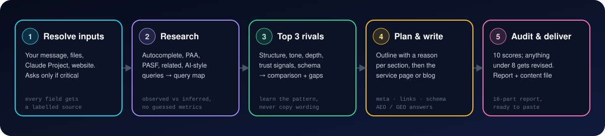
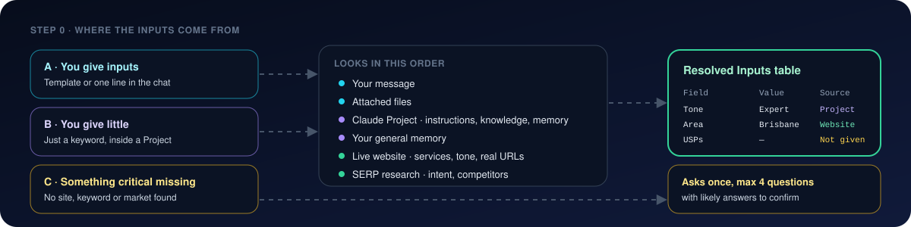

<div align="center">



<br/>

[](CHANGELOG.md)
[](LICENSE)
[](#-what-you-get)
[](#-two-page-types-two-playbooks)

[](#-quick-start)
[](#-inputs-yours-your-projects-or-asked-once)
[](#%EF%B8%8F-rules-baked-in)
[](CONTRIBUTING.md)

### Give it a keyword. Get the research, the competitor breakdown and a page that's ready to publish.

[**🚀 Quick start**](#-quick-start) · [**🧭 Inputs**](#-inputs-yours-your-projects-or-asked-once) · [**📦 What you get**](#-what-you-get) · [**🧠 SKILL.md**](seo-research-content-system/SKILL.md)

</div>

---

## ✨ What it does

Most AI-written SEO pages skip the part that matters: **finding out what's already ranking and why**. This skill makes Claude work like a senior SEO strategist: research first, write second, audit last. Every claim about the business comes from you, your Claude Project or the live website, never from thin air.

<table>
<tr>
<td width="33%" valign="top">

### 🔎 Researches the SERP
Autocomplete, **People Also Ask**, People Also Search For, related searches, featured snippets, AI Overviews and **AI-style prompts**, built into a query map with intent, funnel stage and priority. Observed and inferred data are kept apart.

</td>
<td width="33%" valign="top">

### 🥊 Breaks down the top 3
Structure, headings, tone, depth, trust signals, CTAs, schema and weaknesses of the **top 3 organic pages**, then a comparison table and a **content gap analysis**. It learns the pattern and never copies the wording.

</td>
<td width="33%" valign="top">

### ✍️ Writes and audits
An outline with a reason for every section, then the **publish-ready page** with metadata, internal links, JSON-LD and AEO/GEO answers. It scores **10 categories** and rewrites anything under 8/10 before you see it.

</td>
</tr>
</table>

---

## ⚙️ How it works

<div align="center">

</div>

| Step | What happens | Phase in SKILL.md |
|:-:|---|:-:|
| 1 | Collects project details from your message, attached files, your **Claude Project** and the website. Shows a **Resolved Inputs** table with the source of every value | 0 |
| 2 | Researches the topic and the business: autocomplete, PAA, PASF, related and AI-style queries, then builds a **keyword and query map** | 2 |
| 3 | Analyses the **top 3 relevant organic pages** in the target market and lists what they cover, miss and get wrong | 3 |
| 4 | Applies the **service-page** or **blog** playbook, plans the outline, then writes the page | 4 – 6 |
| 5 | Adds metadata, internal links, schema and AEO/GEO answers, **scores the draft**, revises it and delivers | 7 – 9 |

---

## 🧭 Inputs: yours, your Project's, or asked once

<div align="center">

</div>

<br/>

| Mode | When | What happens |
|:-:|---|---|
| 🅰️ | You fill in the [task template](templates/content-task.md) or describe the page in the chat | Your inputs are the source of truth. Only the gaps get filled in |
| 🅱️ | You type just a keyword inside a client's **Claude Project** | Pulls brand, services, tone, USPs, CTA and key URLs from the Project's instructions, knowledge files and memory, checks them against the website and labels each source |
| 🅲 | A critical field can't be found anywhere | Asks **once**, max 4 questions, with likely answers ready to confirm, then carries on |

<details>
<summary><b>🔑 Which fields are critical, derived or never invented (click to expand)</b></summary>

<br/>

| Type | Fields | Behaviour |
|---|---|---|
| 🔴 **Critical** | Website URL or brand · topic / primary keyword · content type · target country | Asked if missing. Content type and country are worked out from the intent and the domain when it's obvious |
| 🟢 **Derived** | Industry, audience, services, tone, location, CTA, intent, secondary keywords, word count, internal URLs, competitors, existing page | Filled in from your Project, the website or research, and labelled |
| 🟡 **Never invented** | USPs, credentials, licences, awards, years in business, testimonials, ratings, case-study results, prices, guarantees, schema addresses and authors | Used only if you supply them or they're on the site. Otherwise listed under **Missing proof / inputs to add** |

Sources rank: **your message › attached files › Claude Project › memory › website**. If two sources disagree, the table shows the conflict instead of quietly picking one.

</details>

> [!TIP]
> Save a filled copy of [`templates/project-brief.md`](templates/project-brief.md) in each client's **Claude Project knowledge**. After that, one line is enough: *"Service page for epoxy garage flooring Brisbane."*

---

## 📄 Two page types, two playbooks

<table>
<tr>
<td width="50%" valign="top">

### 🛠️ Service page
Built to win **qualified leads** on commercial and local queries.

- Clear service-led H1 and value up front
- Problem → solution → inclusions → process
- Who it's for, use cases, service area
- Cost factors, only if they're verified
- Trust signals and proof, only if they're real
- Objections, FAQs and a strong CTA
- Deeper questions get their own supporting articles, so the page doesn't fill up with blog content

</td>
<td width="50%" valign="top">

### 📝 Blog article
Built to give the **best answer** and build topical authority.

- Answers the question early, with no generic intro
- Logical H2 / H3 structure from real user questions
- Steps, examples, tables, checklists
- Mistakes, limits and misconceptions
- FAQs only where they add something new
- Links to related service pages
- Sources for facts and anything date-sensitive

</td>
</tr>
</table>

---

## 📦 What you get

One full report plus a separate **content-only file** you can paste straight into WordPress or any CMS.

<details open>
<summary><b>📑 The 16-part report</b></summary>

<br/>

| # | Section | What's in it |
|:-:|---|---|
| 0 | 🧭 **Resolved Inputs** | Every field, its value and where it came from, plus conflicts and assumptions |
| 1 | 🎯 **Executive Summary** | Topic, audience, intent, business goal |
| 2 | 🔬 **Research Methodology** | Engines, tools, location and date context, limitations |
| 3 | 🔎 **Keyword & Query Research** | Autocomplete, PAA, PASF, related and AI-style queries, marked *observed* or *inferred* |
| 4 | 🥊 **Top 3 Competitor Analysis** | URL, structure, tone, coverage, trust signals, weaknesses |
| 5 | 📊 **Competitor Comparison Table** | Side-by-side on the factors that matter |
| 6 | 🕳️ **Content Gap Analysis** | Missed questions, weak explanations, chances to add unique value |
| 7 | 🗺️ **Recommended Outline** | H1 / H2 / H3 with the purpose and target query of each section |
| 8 | ✍️ **Publish-Ready Content** | The finished service page or blog article |
| 9 | 🏷️ **SEO Metadata** | Title + alternative, meta description, slug, H1, Open Graph |
| 10 | 🔗 **Internal Linking Plan** | Source → target → anchor → placement → reason, using real URLs only |
| 11 | 🧩 **Schema** | Eligible types and JSON-LD built from verified details |
| 12 | 🤖 **AEO / GEO** | Direct answers, definitions, entities, sources |
| 13 | ✅ **Quality Audit** | 10 scores with reasons, plus what was revised |
| 14 | 📋 **Implementation Checklist** | Before and after publishing |
| 15 | 🧾 **Missing Proof / Inputs** | USPs, credentials, reviews and prices that would strengthen the page |

</details>

---

## 🚀 Quick start

### In Claude (claude.ai / desktop app)

1. Download [`seo-research-content-system.skill`](seo-research-content-system.skill) (a zip of the skill folder).
2. In Claude, go to **Settings → Capabilities → Skills**, upload it and switch it on.
3. Turn on **web search** so the SERP and competitor research can run.
4. *(Recommended)* Add a filled [`project-brief.md`](templates/project-brief.md) to each client's Claude Project.
5. Ask:

```text
Write a service page for "epoxy garage flooring Brisbane"
```

### In Claude Code

```bash
git clone https://github.com/akifseospecialist-digitalmarketer/seo-research-content-system.git

# for all your projects
cp -r seo-research-content-system/seo-research-content-system ~/.claude/skills/

# or just for one project
cp -r seo-research-content-system/seo-research-content-system .claude/skills/
```

### Without skills (any LLM)

Paste [`prompt/universal-seo-content-prompt.md`](prompt/universal-seo-content-prompt.md) into the chat. Fill in the bracketed fields, or leave them blank and it will ask.

---

## 💬 Example requests

| You type | What happens |
|---|---|
| `Service page for "epoxy garage flooring Brisbane"` | Inside a Project: everything is resolved from the Project and the website, and it asks nothing |
| `Blog for example.com.au on "how long does epoxy flooring last"` | Reads the site, picks *blog article* from the question intent, keeps USPs out unless verified |
| `Rewrite https://example.com/services/roof-repairs/ for "roof repairs Melbourne"` | Uses the live page as the draft, keeps what's accurate, rewrites the rest |
| `Service pages for "commercial epoxy", "garage coating", "polished concrete"` | Resolves the brand once, writes 3 pages and flags keyword overlap |
| `Write a page about roof restoration` | Asks once: which site, service page or blog, which market |
| `…just go, don't ask me anything` | Carries on with clearly labelled *Assumed* values |

More walk-throughs: [`examples/usage-examples.md`](examples/usage-examples.md).

---

## 🛡️ Rules baked in

- 🔬 **Research before writing**: no draft until the research, competitor analysis and outline are done
- 🚫 **Nothing fabricated**: no made-up volumes, SERP positions, citations, testimonials, prices or credentials
- 👀 **Observed vs inferred**: says exactly what it saw and what it reasoned, and admits when a source was out of reach
- ✍️ **Original wording**: learns from competitors' structure, never their sentences
- 📏 **Intent sets the length**: no padding to match the longest competitor
- 🧱 **No doorway pages**: no near-duplicate location pages, and checks for cannibalization with existing URLs
- 🧩 **Honest schema**: only eligible types, only verified details, and no promise of rich results
- 🤝 **No guarantees**: never promises #1, traffic, indexing or AI citations

---

## 🔌 Works better with

| Tool | What it adds |
|---|---|
| **Web search + fetch** | Required: live SERP, PAA and competitor pages |
| **Browser** (Claude in Chrome or the desktop app's browser) | SERP features and pages that don't render via fetch |
| **SEO data connectors**: SE Ranking, Ubersuggest, DataForSEO, Semrush, Ahrefs, Google Search Console | Verified volume, difficulty and current rankings. Without one, metrics show as *Not verified* |
| **Claude Projects** | Remembers each client's brief, tone and key URLs, so requests stay one line |

---

## 📁 Repo structure

```
.
├── seo-research-content-system/
│   └── SKILL.md                         ← the skill: Step 0 input engine + 9 phases
├── seo-research-content-system.skill    ← ready-to-upload package for Claude
├── templates/
│   ├── project-brief.md                 ← save once per client in Claude Project knowledge
│   └── content-task.md                  ← per-page brief for full control
├── prompt/
│   └── universal-seo-content-prompt.md  ← standalone prompt for any LLM
├── examples/
│   └── usage-examples.md                ← six worked request types
├── assets/                              ← banner and diagrams
├── CHANGELOG.md · CONTRIBUTING.md · LICENSE
└── .gitignore
```

---

## 📄 License

MIT. See [LICENSE](LICENSE). The brands and URLs in the examples are fictional.

## 👋 About

Created by **Akif Qureshi | SEO Specialist & Digital Marketer**
🌐 [algoblueprints.com](https://algoblueprints.com)

More skills: [AI Queries Finder](https://github.com/akifseospecialist-digitalmarketer/ai-queries-finder) · [Website Clicks Improver](https://github.com/akifseospecialist-digitalmarketer/website-clicks-improver) · [SEO · AEO · GEO Audit & Working Sheet](https://github.com/akifseospecialist-digitalmarketer/seo-aeo-geo-audit-and-working-sheet) · [GSC Opportunity Finder](https://github.com/akifseospecialist-digitalmarketer/claude-ai-gsc-opportunity-finder) · [AI Prompt Research](https://github.com/akifseospecialist-digitalmarketer/claude-ai-prompt-research-skill) · [SEO Master](https://github.com/akifseospecialist-digitalmarketer/seo-master-skill)
